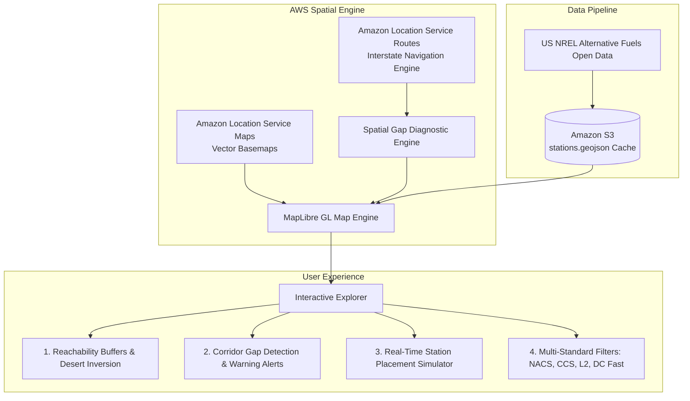

# EV Pulse: EV Corridor & Charging Desert Navigator

> Built for the **AWS Builder Center Weekend Challenge: Map it** (October 30 – November 2, 2026).
> Creator: **Albert Benjamin Asare**


## ⚡ Problem Statement & Story

Electric vehicle adoption is accelerating rapidly, but long-distance highway travel still triggers intense **range anxiety**. Across America's Interstate corridors and high-desert passes (such as the Mojave Desert on I-15, the Sonoran Desert on I-10, and Nevada's Great Basin on US-95), drivers encounter **"Charging Deserts"**—stretches where fast chargers are non-existent or exceed vehicle safety buffers.

**EV Pulse** turns raw spatial infrastructure data into an interactive intelligence map. It visualizes reachability buffers, dynamically calculates corridor gap segments (>38 miles from any fast charger), and allows drivers and municipal infrastructure planners to **simulate placing new chargers** to watch desert gaps close in real-time.

---

## 🗺️ AWS Services & Architecture



1. **Amazon Location Service (Maps)**:
   - Delivers high-performance, dark-theme vector basemap tiles via MapLibre GL JS with custom styling.
2. **Amazon Location Service (Routes)**:
   - Provides interstate route geometry and waypoints to analyze travel distances between urban hubs.
3. **Amazon S3 & AWS Amplify**:
   - Stores and serves the station GeoJSON repository, tilesets, and static web application bundle.
4. **Open Data on AWS (US Department of Energy / NREL)**:
   - Official Alternative Fuel Data Center (AFDC) database of EV charging locations.

---

## 🚀 Key Features

* **Live Reachability Buffers**: Configurable 10 to 50-mile safety buffers around each station. Unshaded areas immediately pop out as charging dead zones.
* **Corridor Gap Diagnostics**: Real-time algorithmic analysis along 5 major US Interstate corridors (I-15, I-10, I-40, I-5, US-95). Automatically highlights uncovered stretches with pulsing red hazard lines.
* **"Place-a-Charger" Sandbox**: Click anywhere on the map to add a hypothetical 350kW Ultra-Fast charger. Watch the coverage buffer expand and the corridor gap alert disappear in real time!
* **Multi-Standard Filtering**: Filter by DC Fast (150-350kW) vs Level 2, connector standards (NACS/Tesla, CCS, CHAdeMO, J1772), and charging networks (Tesla Supercharger, Electrify America, EVgo, ChargePoint).

---

## 🛠️ Local Development & Quickstart

### Prerequisites
* Node.js v18+ (tested on Node v24)
* npm

### Installation
```bash
# 1. Clone repository
git clone https://github.com/your-username/ev-charging-desert-navigator.git
cd ev-charging-desert-navigator

# 2. Install dependencies
npm install

# 3. Launch development server
npm run dev
```
Open [http://localhost:5173](http://localhost:5173) in your browser.

### Optional: Connect Your AWS Account
Click the **Settings** gear icon in the top navigation bar to configure:
- **Amazon Location API Key**
- **AWS Region** (e.g., `us-east-1`, `us-west-2`)
- **Map Resource Name** (e.g., `explore.map`)

---

## 🏆 Hackathon Judging Criteria Alignment

* **Technical Innovation (25%)**: Dynamic point-along-route spatial calculus using Turf.js and Amazon Location geometries to flag dead zones.
* **Craft & Execution (25%)**: Smooth vector rendering, instant response times, rich tooltips, and clean TypeScript code.
* **Usefulness & Impact (25%)**: Directly addresses EV adoption bottlenecks, aiding road-trippers and Department of Transportation infrastructure planners.
* **Creativity & Storytelling (25%)**: Framed around iconic desert transit corridors where range anxiety is acute.
